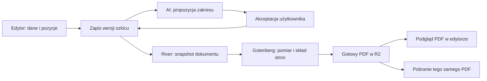

# Integracja wzoru wyceny, paginacji, AI i edytora — plan implementacji

> **For agentic workers:** Use `superpowers:executing-plans` to implement this plan task-by-task after approval and confirmation of the repository scope. Steps use checkbox syntax for tracking. This document does not authorize changes outside chmura-blokserwis.

**Goal:** Generować wyceny zgodne z zatwierdzonym wzorem, z czytelnym zakresem, przewidywalną paginacją i podglądem rzeczywistego dokumentu w edytorze.

**Architecture:** PostgreSQL i UniSourceGO pozostają źródłem zapisanych danych i obliczeń. River nadal obsługuje AI oraz PDF. Wersjonowany szablon wykonuje pomiar i planowanie stron w Chromium/Gotenbergu; Chmura pokazuje ten sam gotowy PDF, który użytkownik pobiera.

**Tech Stack:** Svelte 5/SvelteKit, TypeScript, ConnectRPC/Protobuf, Go, PostgreSQL, River, Gotenberg 9/Chromium, prywatne R2; proponowany lokalny moduł PDF.js do wyświetlania stron.

**Spec:** `docs/wyceny/README.md`, `docs/wyceny/wzor-glowny.pdf`, `docs/wyceny/testy/PAGINACJA.md`. Wybrana koncepcja edytora: „Przestronny edytor” z `wyceny-koncepcje.html` w katalogu wizualizacji tej rozmowy.

Status: plan i audyt lokalnego kodu z 15.11.2026. Proponowane niżej rozszerzenia kontraktu i zachowania AI nie zostały wdrożone ani uzgodnione jako odrębne funkcje. Nie sprawdzano aktywnych wersji i konfiguracji produkcji.

## Global Constraints

- Zatwierdzony PDF jest wzorcem wizualnym; nie zmieniać go podczas integracji. Główna kolejność: Wycena → suma → Zakres. Układ obok siebie pozostaje możliwym późniejszym rozszerzeniem, nie warunkiem pierwszej integracji.
- Bez nagłówka „Oferta techniczna”, numerów sekcji, automatycznego wstępu i zakończenia, jednostek po ilości oraz sztucznego rozciągania strony.
- Zachować pełny tekst, kolejność pozycji, obliczenia dziesiętne backendu, ręczne zmiany, ochronę wersji i idempotencję. AI nie ustala ilości, cen ani sum.
- Stopka: firma/wspólnicy/NIP po lewej, licznik wyśrodkowany względem osi X strony, telefon/e-mail/WWW po prawej. Dane z makiety trzeba potwierdzić przed wydaniem klientom.
- Dokumenty historyczne i gotowe obiekty R2 pozostają niezmienne. Nowa wersja wyglądu nie oznacza ponownego zapisywania starych wycen.
- UniSourceGO `/Users/daniel/Projects/UniSourceGO` jest w tej pracy referencją tylko do odczytu. Zadania backendowe poniżej są zależnością do osobnego zatwierdzenia zakresu. Nie stosować lokalnych linków pakietów ani zastępczego backendu w Chmurze.
- Nie wykonywać wdrożeń, płatnych generowań AI ani migracji produkcyjnych w ramach przygotowania tego planu.

## Review Focus

1. AI kończy po ręcznej edycji, zapisie w drugiej karcie albo archiwizacji: nie nadpisuje tekstu; zastosowanie nieaktualnej propozycji wymaga rozwiązania konfliktu (zadania 3 i 5).
2. Nowy klient i stary klient edytują dokument o nowym schemacie: stary zapis nie może usunąć nowych pól, nawet gdy zmiana Protobuf jest addytywna (zadanie 1).
3. Granica strony zmienia się po załadowaniu fontu, wielkim tytule lub długim identyfikatorze: pomiar jest rzeczywisty, tekst pozostaje kompletny albo eksport zwraca błąd (zadania 2 i 6).
4. Gotowy plik dotyczy wcześniejszego szkicu/rewizji albo wygasł podpisany URL: podgląd ma właściwą tożsamość i odświeża link bez ponownego renderowania (zadanie 4).
5. 500 pozycji, długi zakres i seria zmian przy otwartym podglądzie: kolejka i planner nie produkują nieograniczonej pracy ani częściowego PDF-a (zadania 2, 4 i 6).

## 1. Co faktycznie działa i gdzie są braki

Sprawdzono checkout Chmury `ca8e092` oraz referencyjny backend `1c41720`, gałąź `codex/quotes-v1`. Istniejące niezacommitowane zmiany UI pozostawiono bez zmian.

| Obszar | Obecny mechanizm | Znaczenie dla integracji |
| --- | --- | --- |
| Dostęp | `src/lib/api.ts`, nawigacja w `src/routes/+layout.svelte`; backend `internal/quotes/rpc.go` | Moduł widoczny przy ustawionym `PUBLIC_QUOTES_API_URL`. Backend sprawdza Clerk, właściwy origin i aktywną organizację Blokserwis, nie samą rolę admina. Tryb demonstracyjny nie dowodzi działania autoryzacji. |
| Edytor | `src/lib/quotes/QuoteEditor.svelte` | Autosave po 800 ms, wersja oczekiwana, klucze idempotencji, zachowanie formularza po konflikcie, historia, archiwizacja, odzyskiwanie operacji. To należy zachować. |
| Pozycje | `QuoteLines.svelte`, `ui.ts`, backend `calculation.go` i `revisions.go` | Front pokazuje pomocniczą wartość z dokładnym mnożeniem, backend wylicza dokument. Nowe wyceny są brutto. Stare netto nie mogą zostać przemianowane na brutto. |
| Import | `import_rpc.go`, `xlsx.go`, `ai_mapping.go`, `jobs.go` | Limit 5 MiB, do 500 pozycji, próbki do mapowania AI, ręczne mapowanie i przegląd przed zastosowaniem. Nie zastępować obliczeń AI; zachować wszystkie ostrzeżenia. |
| Dane dokumentu | `proto/unisource/v2/quotes.proto` | Brakuje opisu pozycji, daty dokumentu i listy podsekcji zakresu. Są cztery płaskie pola: introduction/scope/technical_description/conclusion. Makiety zawierają dane, których obecny kontrakt nie zapisze. |
| AI | `ai_provider.go`, `ai_worker.go`, `ai_rpc.go`, `brave.go` | Generuje cztery obowiązkowe niepuste sekcje. Otrzymuje nazwy pozycji, nie kontekst ręcznie ustalonego zakresu. Wynik zapisuje automatycznie, jeżeli wersja szkicu się zgadza. To nadal może zastąpić ręczny opis wpisany przed uruchomieniem AI. |
| Limity AI | `descriptionInputs`, `decodeDescription` | Nazwy są ucinane przez przerwanie listy po 20 000 bajtów bez komunikatu o pominiętych pozycjach. Walidacja odrzuca znane komentarze asystenta, ale nie dowodzi zgodności parametrów z urządzeniami. |
| Research | `brave.go` | Maksymalnie sześć rozpoznanych nazw/modeli; przekazywane są tytuły i opisy wyników wyszukiwarki. Kod nie pobiera i nie weryfikuje kart producenta. Nie traktować fragmentów wyników jako potwierdzonych parametrów. |
| PDF | `branded_template.go`, `revisions.go`, `pdf.go`, `pdf_rpc.go` | Szablon bieżący ma wersję 3, stary wygląd i zwykły przepływ CSS. River zapisuje PDF do prywatnego R2; gotowy obiekt jest ponownie używany. Prototyp paginacji nie jest podłączony. |
| Wersjonowanie | `quote_revisions`, `quote_documents` | Rewizja ma snapshot i template_version. Dokument szkicu ma snapshot, ale renderer bierze wersję szablonu z bieżącej stałej. Zmiana wdrożenia może więc zmienić wynik ponowienia tego samego niegotowego szkicu. |
| Metryka | `quoteSnapshot` w `revisions.go` | Nie przechowuje daty wystawienia ani danych wystawcy. Numer jest nadawany jako `WYC/rok/licznik`; numeru z przykładowego PDF-a nie należy hardcodować ani wprowadzać nowego systemu numeracji przy zmianie szablonu. |
| Podgląd | `QuotePreview.svelte`, `preview.ts`, `GetQuotePreview` | Ciągły HTML z marginesami ekranu. Bez rzeczywistych stron i stopek; nie jest potwierdzeniem wyglądu PDF. `showPreview` chroni kolejność żądań, ale nie porównuje zwróconego draft_version przed przyjęciem HTML. |
| Renderer | `compose.quotes-coolify.yaml`, `compose.production.yaml`, `compose.quotes-acceptance.yaml` | Zapisana konfiguracja Gotenberga wyłącza JavaScript, blokuje sieć i ma timeout 40 s. Klient HTTP ma 45 s, job PDF 75 s. Sama zamiana szablonu nie uruchomi pomiaru JS. |
| Testy eksportu | `e2e/quotes-flow.ts`, backend `pdf_test.go` | Sprawdzają m.in. `%PDF-` i długość odpowiedzi. To nie dowodzi poprawności stron ani zachowania treści. Domyślny renderer integracyjny zwraca atrapę PDF; prawdziwy jest opcjonalny. |

## 2. Wybór sposobu integracji

Rekomendacja: **obecny Go/River/Gotenberg, z wersjonowanym kodem składu w rendererze; podgląd z wynikowego PDF-a**. To propozycja techniczna do realizacji, a nie deklaracja działającej integracji.

Rozważone alternatywy:

- Sam Go + CSS: mniej zmian infrastruktury, ale bez rzeczywistych pomiarów Chromium nie zachowa planowania i oceny wariantów z prototypu.
- Osobny serwis Node/Playwright: łatwy port obecnego skryptu i dostęp do diagnostyki, ale nowy proces, wdrożenie i kolejny punkt utrzymania. Rezerwa, gdy próba z docelowym Gotenbergiem wykaże ograniczenie.
- Skład w istniejącym Gotenbergu: wykorzystuje obecną kolejkę i storage; wymaga dopuszczenia zaufanego JS szablonu, sygnału gotowości oraz testu czasu pracy. Tę drogę sprawdzić najpierw.

Dokumentacja Gotenberga opisuje `waitForExpression`, które pozwala zaczekać na gotowość złożonej strony: [Convert HTML to PDF](https://gotenberg.dev/docs/chromium/convert-html). Samo występowanie opcji w dokumentacji nie zastępuje testu używanego obrazu 9.0.0.

Przepływ docelowy:

## 3. Kontrakt dokumentu i zasady treści

Proponowane rozszerzenie istniejącego `unisource.v2.QuoteService`, bez tworzenia drugiego API:

- `QuoteLine.description`, pole 6: opcjonalny tekst pod nazwą. Nazwy/ilości/ceny pozostają osobnymi danymi. Limit 2 000 bajtów UTF-8 na opis; łączny budżet opisów pozycji i zakresu 24 000 bajtów.
- `QuoteScopeSection { heading = 1; body = 2; }`: uporządkowana lista podsekcji. Maksymalnie 30 sekcji; nagłówek do 120 bajtów, treść do 12 000 bajtów, z zachowaniem budżetu łącznego. Bez pustych podsekcji w publikacji; szkic może zawierać rozpoczętą edycję.
- `QuoteDraft.document_date`, pole 9: data `YYYY-MM-DD`, początkowo dzień utworzenia w Europe/Warsaw, edytowalna. Nie wyliczać daty ponownie przy eksporcie.
- `QuoteDraft.scope_sections`, pole 10; `document_schema_version`, pole 11: 2 dla nowego modelu. Wartość 0 oznacza obecne starsze dane. Numery 1–8 pozostają zarezerwowane dla obecnych pól.
- `QuoteDraft.description_standard`, pole 12: enum UNSPECIFIED/GENERAL/MONITORING/ACCESS_CONTROL/INTERCOM. To dobór redakcyjnych podsekcji i przykładów, nie automatyczny katalog parametrów ani robocizny.
- Snapshot dokumentu uzupełnić o datę, pełne dane wystawcy i wersję szablonu. Wystawca pochodzi z jednej wersjonowanej konfiguracji backendu; na tym etapie bez nowego panelu administracyjnego. W snapshot trafiają wartości, nie odwołanie do bieżącej konfiguracji.
- Szablon 4 obsługuje nowy model. Dotychczasowe rewizje 1–3 zachowują dotychczasowy wygląd. Zamiana istniejącego szkicu na nowy format wymaga widocznego podglądu wszystkich starych pól; nie ukrywać ani usuwać wstępu i zakończenia podczas odczytu.
- Stary klient wysyłający pełny SaveDraft dla dokumentu schematu 2 ma dostać FailedPrecondition zamiast wyzerować nowe pola. Wymaga to testu rzeczywistego round tripu starego payloadu, nie tylko zgodności plików proto.

Zakres opisuje wyłącznie to, co wynika z podanych pozycji i ustaleń. Przykładowe standardy: Monitoring → urządzenia / infrastruktura / prace; Kontrola dostępu → elementy systemu / montaż / uruchomienie. Sekcja pojawia się wyłącznie, gdy ma potwierdzoną treść. Sam zakup kamery nie potwierdza montażu, konfiguracji, prowadzenia przewodów ani gwarancji. Nie wymuszać trzech akapitów, gdy wystarcza jeden.

## 4. Zadania wdrożeniowe

### Zadanie 1: Zapisywalny model nowego dokumentu i niezmienne snapshoty

**Backend — osobny zakres:** zmienić `proto/unisource/v2/quotes.proto`, `internal/quotes/rpc.go`, `revisions.go`, `pdf_rpc.go`, zapytania w `internal/db/queries/quotes.sql`; nowa migracja w `internal/db/migrations/` według bieżącej kolejności, następnie wygenerowane bindingi.

**Chmura:** zsynchronizować `proto/unisource/v2/quotes.proto` i wygenerować `src/lib/gen/unisource/v2/quotes_pb.ts`, bez ręcznej edycji wygenerowanego klienta.

**Interfejs:** `QuoteDraft` opisany powyżej; snapshot i rekord `quote_documents` przypinają template_version przy kolejkowaniu. Migracja starych rekordów przypisuje wersję 3 dla dotychczasowych szkiców, dla rewizji bierze ich zapisaną wersję; nie zmienia gotowych PDF-ów.

- [ ] Napisać testy zapisu/odczytu opisów i podsekcji, limitów UTF-8, daty, braku nowych pól w starym kliencie i odtwarzania starych rewizji.
- [ ] Testować ponowienie PDF-a po zmianie bieżącego szablonu i danych firmy: te same dane snapshotu oraz przypięta wersja nadal obowiązują.
- [ ] Wprowadzić rozszerzenie, walidację i migrację. Publikacja wymaga tytułu, klienta, daty, pozycji i kompletnej konfiguracji firmy; AI i zakres pozostają opcjonalne.
- [ ] Uruchomić testy backendu i porównanie kontraktu obu repozytoriów. Stare szkice netto zachowują semantykę i dotychczasowy renderer, dopóki nie powstanie jawna konwersja; nie zmieniać cen automatycznie.

### Zadanie 2: Produkcyjny skład w Gotenbergu

**Źródło do przeniesienia:** `docs/wyceny/testy/pagination.mjs`, pomiary i fragmentacja z `adaptive-pdf.mjs`, style `wzor.css`. Nie przenosić ścieżek `/Users/daniel`, danych testowych, lokalnego sterowania Playwright ani stałych kwot.

**Backend — osobny zakres:** nowe `internal/quotes/assets/layout-v4.js`, `document-v4.css`, `internal/quotes/document_v4.go`; zmiany `revisions.go`, `pdf.go`, `pdf_test.go` oraz trzech plików compose wskazanych w audycie.

**Interfejs:** osadzony w szablonie moduł `composeQuoteDocument(): Promise<void>` mierzy DOM, buduje strony i dopiero po walidacji ustawia `window.__quoteLayout = { status: 'ready', pageCount, mode }`; przy błędzie ustawia `{ status: 'error', code }`. Go wybiera opcje renderowania według przypiętej wersji szablonu.

- [ ] Najpierw uruchomić małą próbę na obrazie Gotenberg 9.0.0: osadzony skrypt, ładowanie fontu i logo, `waitForExpression`, kontrolowany błąd układu. Nie zmieniać konfiguracji produkcji w ramach próby.
- [ ] Zarejestrować jawnie renderery wersji 1/2/3/4. Obecny warunek w `pdfWorker.Work` dopuszcza 1, 2 i bieżącą stałą; samo przestawienie stałej z 3 na 4 odrzuciłoby ponowienia wersji 3. Dodać test dokładnie tej regresji.
- [ ] Zastosować stały, zaufany kod szablonu; dane użytkownika jako bezpiecznie serializowane dane, a potem `textContent`. Przetestować `</script>`, HTML i fragmenty kodu w nazwach/opisach. Zachować blokadę sieci renderera; nie włączać skryptów dokumentu w przeglądarce użytkownika.
- [ ] Przenieść planner z sześcioma profilami odstępów/typografii i wymiarami 19 mm bocznie, 17 mm od góry, 30 mm rezerwy dolnej, 249 mm obszaru planowania. Zachować 9/7,5/8,5 pkt dla nazw/opisów/zakresu; tytuł 25→22, nagłówki 14→12,5, suma 22→20 pkt.
- [ ] Mierzyć po `document.fonts.ready` i `image.decode()`. Zwykły wiersz niepodzielny, suma przy ostatnim wierszu, nagłówek z treścią; długie bloki dzielone po rzeczywistych liniach bez utraty znaków. Uzupełnić fragmentację ciągów bez spacji: pomiar zakresów po grafemach, gdy podział na słowa nie wystarcza.
- [ ] Celem jest minimalna liczba czytelnych stron i lepsze zapełnienie ostatniej; próg 40% jest składnikiem oceny, nie wymogiem dla każdych danych. Nie dopisywać tekstu i nie zmniejszać danych w celu jego osiągnięcia.
- [ ] Zastąpić zmienny font wersjami statycznymi o potrzebnych grubościach, zachować licencję i sprawdzić kopiowanie znaków bez normalizacji obejść audytu. Rozwiązanie zatwierdzić dopiero po renderze, nie na podstawie samego formatu fontu.
- [ ] Czekać na gotowość przez `waitForExpression`; błąd składu ma przerwać konwersję, nigdy dopuścić do PDF-a z przycięciem. Obsługę błędu wyrażenia i odpowiedzi Gotenberga potwierdzić testem. Dla błędu deterministycznego bez bezcelowych trzech prób; awarie transportu nadal mogą być ponawiane przez River.
- [ ] Sprawdzić pełne limity API: 500 pozycji × sześć profili. Ograniczyć niepotrzebne pomiary, nie budować kopii wszystkich ścieżek DP. Utrzymać całkowitą konwersję poniżej 40 s; jeśli limit nie jest osiągalny, zatrzymać integrację na tym kryterium i zmierzyć przyczynę, zamiast przycinać dane.

### Zadanie 3: AI tworzące propozycję zakresu

**Backend — osobny zakres:** `ai_provider.go`, `ai_worker.go`, `ai_rpc.go`, `ai_provider_test.go`, nowy `description_standards.go` z przykładami oraz rozszerzenie proto.

**Interfejs:** zachować `GenerateQuoteText`; dla schematu 2 wynik trafia do operacji jako `proposed_scope_sections` — nowe pole 8 `GetQuoteOperationResponse`. Nowy RPC `ApplyQuoteText` przyjmuje `quote_id`, `operation_id`, `expected_version`, `idempotency_key` i zwraca `Quote`. To akceptacja całej propozycji; późniejsza edycja jest zwykłym SaveDraft.

- [ ] Napisać testy: wynik AI nie zmienia szkicu; akceptacja zapisuje raz; konflikt wersji, archiwizacja i operacja innej wyceny nie nadpisują danych; ponowne przesłanie tego samego klucza jest bezpieczne.
- [ ] Zmienić schemat odpowiedzi z czterech obowiązkowych tekstów na listę podsekcji. Prompt zawiera krótkie standardy i kontrprzykłady; brak wstępu, reklamy, zakończenia, formuł typu „kompleksowe rozwiązanie” i opisów procesu AI.
- [ ] Wejście zawiera nazwy, ręczne opisy pozycji, wybrany standard i istniejące potwierdzone ustalenia. Nie przesyłać cen, NIP ani danych klienta, gdy nie są potrzebne do opisu. Wynik może zmienić tylko zakres, nie nazwy modeli, ilości, ceny i ręczne opisy pozycji.
- [ ] Usunąć ciche pomijanie pozycji. Powyżej limitu wejścia odrzucić uruchomienie z FailedPrecondition i czytelnym komunikatem „Za dużo treści do jednego opisu AI”; ręczne tworzenie i PDF nadal działają. Nie wprowadzać ukrytych dodatkowych płatnych wywołań.
- [ ] Research pozostaje szczegółem aktywności. Nie dodawać do PDF-a parametrów znanych tylko z fragmentu wyników wyszukiwania. Bez osobnego mechanizmu weryfikacji kart producenta preferować opis funkcji i danych podanych przez użytkownika.
- [ ] Zachować obsługę terminalnego zakończenia streamu, niepewnego wyniku i brak automatycznego ponawiania potencjalnie płatnej operacji. Partial JSON nie jest danymi szkicu.
- [ ] Stan succeeded dla nowego schematu oznacza „Propozycja gotowa”, a nie „Zapisano opis”. Zastosowanie wymaga zarówno zgodnej expected_version, jak i zgodności bieżącej wersji z wersją źródłową generowania. Stary format zachowuje poprzednie zachowanie do jawnej konwersji dokumentu.

### Zadanie 4: Podgląd wynikowego PDF-a

**Chmura:** `QuotePreview.svelte`, `QuoteEditor.svelte`, nowy `pdf-preview.ts`, testy komponentu i `e2e/quotes-layout.spec.ts`; dodać PDF.js i jego worker z lokalnego bundla w wersji dobranej przy implementacji.

**Backend — osobny zakres:** istniejące `GenerateDraftPdf`/`GetQuotePdf`/`RetryQuotePdf`, `storage.go`/`pdf.go` i CORS bucketu środowiska testowego. Rozszerzyć `GetQuotePdfResponse` o `template_version`, pole 7; numeracja stron może być odczytana przez PDF.js. Nie zwracać długowiecznego publicznego URL-a.

- [ ] Ustalić tożsamość podglądu: quote_id + draft_version lub revision + przypięta template_version. Sprawdzać ją po każdej odpowiedzi; starsze wyniki nie podmieniają nowszego widoku.
- [ ] Otworzenie podglądu zapisuje zmiany i zapewnia istnienie PDF-a bieżącej wersji. Ponowne otwarcie tej samej wersji nie tworzy kolejnego zadania. Przycisk generowania i automatyczne odświeżenie współdzielą jeden kontroler.
- [ ] Przy otwartym podglądzie odświeżać po 1,5 s od ostatniego potwierdzonego zapisu. Jeden lokalny render w toku; zmiany w tym czasie scalane do najnowszej wersji. Gdy panel zamknięty, samo pisanie nie generuje PDF-ów. Backend ogranicza aktywne zadania szkicu do jednego na wycenę i nie rozpoczyna nieaktualnych, jeszcze niewykonanych zadań; historyczne rewizje nie są pomijane.
- [ ] PDF.js pobiera plik krótkotrwałym podpisanym URL-em i pokazuje strony wraz z warstwą tekstową, zoomem, numeracją i dopasowaniem do szerokości. Renderować widoczne strony i sąsiednią, nie setki canvasów naraz. Anulować zadania i zwalniać bufory przy zmianie dokumentu.
- [ ] Zapewnić CORS dla GET z originu aplikacji; najprostszy wariant pobiera plik w całości w limicie 20 MiB i wyłącza żądania Range. Po wygaśnięciu URL pobrać nowy link przez GetQuotePdf, nie tworzyć PDF-a ponownie. Użytkownik ma też dostępne pobranie pliku.
- [ ] Podczas edycji zachować poprzedni podgląd z komunikatem „Podgląd poprzedniej zapisanej wersji”. Awaria podglądu nie czyści formularza ani gotowego poprzedniego pliku.
- [ ] Dla schematu 2 zrezygnować z GetQuotePreview jako źródła widoku; stary ekran HTML może pozostać dla starych dokumentów. Nie włączać `allow-scripts` w obecnym iframe, aby uruchomić planner u użytkownika.

### Zadanie 5: Edytor zgodny z dokumentem i koncepcją „Przestronny edytor”

**Chmura:** `QuoteEditor.svelte`, `QuoteLines.svelte`, `QuoteActionBar.svelte`, `QuoteAiActivity.svelte`, `ai-progress.ts`, `ui.ts`; nowe `QuoteScopeEditor.svelte` i `QuoteAiProposal.svelte` z własnymi testami. Nie przebudowywać całej aplikacji ani globalnej nawigacji.

- [ ] Podzielić sekcje na Dane, Pozycje, Zakres, Dokumenty. W Danych tytuł, klient i data; przy pozycjach opcjonalny opis; w Zakresie edytowalne podsekcje z dodawaniem, usuwaniem i zmianą kolejności przyciskami.
- [ ] Po generowaniu AI pokazać propozycję obok dotychczasowego tekstu lub jako przełączany widok na małym ekranie. Akcje „Zastosuj zakres” i „Zostaw obecny”. Jeśli są niezapisane zmiany, zachować je i zablokować zastosowanie nieaktualnej propozycji; nie automatycznie wywoływać płatnej regeneracji.
- [ ] Zachować autosave, stan dirty/saving/error, idempotencję i blokadę wyjścia. Podczas konfliktu pokazać drogę odzyskania własnego tekstu i wczytania wersji serwera; samo wielokrotne ponawianie tej samej starej expected_version nie jest rozwiązaniem konfliktu.
- [ ] Uporządkować odstępy na skali 4/8/12/16/24/32 px. Panel 16 px mobile i 24 px desktop; odstęp etykieta/pole 6–8 px. Przyciski min. 44 px, wyśrodkowana etykieta i ikona. Tekst opisowy do lewej, ilość do środka, kwoty do prawej, wyśrodkowanie pionowe wierszy.
- [ ] Edytor ma pierwszeństwo szerokości. Podgląd domyślnie zamknięty; dwa panele tylko gdy zostaje min. 640 px dla edycji i 420 px dla podglądu. Na węższych ekranach przełącznik Edycja/Podgląd; nie wciskać tabeli do wąskiej kolumny według samej szerokości viewportu.
- [ ] Na mobile zachować zwarte podsumowania pozycji i rozwijanie jednej edycji. Stopka akcji uwzględnia wysokość panelu transferu i safe area; aktywne pole oraz ostatnia pozycja pozostają dostępne przy otwartej klawiaturze.
- [ ] „Zapisz szkic” pozostaje zapisem roboczym. Dla opublikowanej wyceny zmienić niejasne „Zapisz zmiany” na „Opublikuj rewizję”; akceptacja propozycji AI nie publikuje dokumentu.

### Zadanie 6: Testy rzeczywistego przepływu i dokumentów

**Chmura:** `e2e/quotes-flow.ts`, `quotes-integrated.spec.ts`, `quotes-live.spec.ts`, `quotes-layout.spec.ts`, testy modułu; `docs/wyceny/testy/fixtures.mjs`, `audit-pdf.py` i nowy adapter fixtures → QuoteDraft.

**Backend — osobny zakres:** `rpc_integration_test.go`, `pdf_test.go`, `revisions_test.go`, testy AI i docelowy obraz Gotenberga. Używać izolowanej bazy oraz storage testowego.

- [ ] Przepuścić wszystkie 16 dotychczasowych przypadków przez SaveDraft → River → Gotenberg → R2 → pobranie. Dopasować wielki opis pojedynczej pozycji do nowego limitu 2 000 bajtów; test większego wejścia ma potwierdzać odrzucenie przed kolejką. Nie polegać na kopiowaniu wyników prototypu.
- [ ] Dodać: 500 pozycji, maksymalny łączny tekst, same długie identyfikatory, bardzo szerokie kwoty, klient do 2 000 bajtów, maksymalny tytuł, brak zakresu, pusta wycena, stare netto, próba wstrzyknięcia kodu, niezaładowany font, awaria i ponowienie renderera. Dla danych niemieszczących się w metryce określić komunikat walidacji, nie przycinać.
- [ ] Audyt pobranego pliku: parsowalny PDF, pełna zgodna treść i kwoty, liczba stron, marginesy, brak kolizji/ucięcia, suma z pozycją, stopka na każdej stronie, licznik w osi X, dolne granice czcionek. Porównanie tekstu bez zamienników wadliwego fontu.
- [ ] Zapełnienie ostatniej strony oceniać względem legalnych podziałów. Dla dotychczasowego zestawu oczekiwać co najmniej 40%; dla nowej granicy niepodzielnego bloku dopuszczać uzasadniony wyjątek z raportem, nie fałszywie obiecywać gwarancji.
- [ ] W przeglądarce sprawdzić 320/390/768/1024/1280/1440 px, powiększenie interfejsu 200%, zmianę rozmiaru otwartego podglądu, klawiaturę/focus i transfer. Podgląd i pobranie wskazują ten sam artefakt; porównać liczbę stron i tekst PDF, nie DOM starego iframe.
- [ ] Testy AI: odpowiedź poprawna, odmowa/ucięcie/niepoprawny schemat, próba zmiany cen, komentarz asystenta, niewspierany parametr, brak wyników researchu, limit wejścia, konflikt, odłączenie streamu i odświeżenie strony. W CI provider jest atrapą; jeden jawnie autoryzowany test płatny jest osobnym etapem.
- [ ] Test członka organizacji i konta spoza niej z prawdziwym Clerk na środowisku akceptacyjnym. Widoczność modułu, wybór aktywnej organizacji, zapis i prywatne pobranie mają działać bez administracyjnego obejścia.

### Zadanie 7: Wydanie i odbiór

**Backend i infrastruktura — osobny zakres:** osobno API, quote-worker, Gotenberg i migracja. **Chmura:** zgodny klient, bundlowany viewer, widoczność funkcji zależna od dostępnego kontraktu.

- [ ] Potwierdzić rzeczywiste dane firmy i stopki. Porównać plik z prawdziwymi danymi z zatwierdzonym wzorcem; uzyskać odbiór wizualny.
- [ ] Najpierw migracja addytywna i backend obsługujący stare/nowe dane, następnie zgodny worker i renderer, potem frontend. Nie tworzyć zadań v4, zanim worker je rozumie. Włączyć nowe dokumenty po udanym odbiorze środowiska testowego.
- [ ] Sprawdzić aktywne wersje API i workera, konfigurację Gotenberga, origin Clerk, CORS R2 oraz rzeczywisty zapis/pobranie. Build i healthcheck nie są końcem odbioru.
- [ ] Gotowych PDF-ów nie zastępować. Poprawka dokumentu to nowa rewizja. W razie regresji wyłączyć tworzenie nowych dokumentów v4, zachować zapis i odczyt istniejących; rollback frontendu nie może przywrócić klienta kasującego pola schematu 2.

## 5. Kolejność i warunki ukończenia

1. Kontrakt + snapshoty (zadanie 1), potem renderer i pomiar czasu (2). To pierwszy etap: poprawny nowy PDF z ręcznie wpisanej treści, bez zależności od AI.
2. Propozycje AI (3) oraz podgląd z gotowego PDF-a (4), następnie domknięcie edytora (5). Testy właściwe dla każdego zadania powstają wraz z nim.
3. Cały przepływ i brzegowe dane (6), a dopiero potem wydanie (7).

Ukończenie integracji oznacza: rzeczywisty zapis pól, propozycję AI i świadome zastosowanie, prawidłowy PDF dla krótkich i długich danych, taki sam podgląd/pobranie, niezmienność starych rewizji, działanie na mobile oraz odbiór z prawdziwą sesją w środowisku akceptacyjnym. Lokalne próbki i mocki nie wystarczają.

Przed wykonaniem zadań backendowych potrzebne jest rozszerzenie zakresu pracy na UniSourceGO. W obecnym repo można przygotować przypadki testowe i warstwę UI na zatwierdzonym kontrakcie; nie można zakończyć integracji przez sam frontend.

## 6. Weryfikacja wykonana podczas przygotowania planu

| Polecenie | Wynik zaobserwowany 15.11.2026 |
| --- | --- |
| `pnpm exec vitest run src/lib/quotes` | 5 plików, 34 testy przeszły; ostrzeżenie `transform_index_html_unsupported`. |
| `pnpm test:e2e:quotes-layout` | 5/5 przeszło: 320/390/1280/1440 px i panel transferu. Są to testy z atrapą Clerk i RPC. |
| `node --test docs/wyceny/testy/pagination.test.mjs` | 8/8 przeszło. Testy lokalnego planera, nie renderera aplikacji. |
| `pnpm exec node scripts/check-proto.mjs --quotes-backend /Users/daniel/Projects/UniSourceGO` | Kontrakty identyczne; wygenerowany klient aktualny. |
| `go test -json ./internal/quotes` w referencyjnym backendzie | 28 testów przeszło; `TestQuoteDraftTransactions` pominięty z powodu braku dostawcy Docker/PostgreSQL. |

Nie uruchomiono płatnego AI, testu prawdziwego R2/Clerk ani Gotenberga. Nie wykonano zmian kodu produktu, migracji, commitów i wdrożeń. Audyt jest podstawą planu integracji, nie potwierdzeniem gotowości produkcyjnej.
